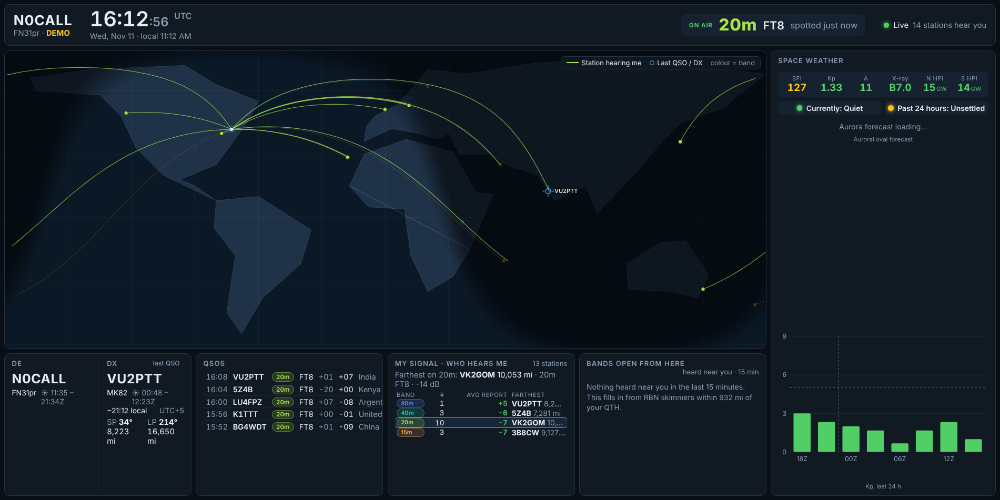

# QTHClock

A shack display built around **your station**. It combines HamClock's at-a-glance operating info with DXLook-style live signal reports, but only shows what matters to you:

- **My signal:** who is hearing you right now on each band, the **average signal report** you're getting (each station's latest report, averaged per mode), and the farthest station (PSK Reporter + RBN).
- **DX near you:** cluster and RBN spots heard by skimmers close to your QTH, so these are stations you can very likely work. Filter by the modes and bands you're working; your own country is hidden by default (optionally your whole continent).
- **QSOs:** who you're working right now (live from WSJT-X, with TX/RX) and your latest QSOs from **Wavelog** and/or WSJT-X. Starting a QSO makes that station the DX automatically.
- **Heard here** (off by default): what your own receiver is decoding, fed live from WSJT-X / JTDX.
- **DE / DX:** your location and the selected station's: local time, sunrise and sunset, short- and long-path bearing and distance. Click any station on the map or in a list to make it the DX.
- **Map** of the whole world with the gray line. Lines and dots run from you to each **station hearing you** (dot = where that station is); hollow rings are **DX spotted near you** that you could work; the white line is the station you're **working now**. Colour = band.
- **Solar:** SFI, Kp and X-ray class from NOAA.



Spots from everyone else in the world are filtered out on the server, so the screen stays calm and the feeds stay light.

## Install and run

QTHClock needs **only Go 1.22 or newer** to build and run. The web front end is already compiled (`web/dist`), so you don't need Node or TypeScript unless you change the front-end code.

### Raspberry Pi / Debian / Ubuntu

```sh
git clone https://github.com/jnunham/qthclock.git
cd qthclock
./scripts/install-prereqs.sh   # installs Go from go.dev (Debian's golang package is too old)
source ~/.profile              # once, so this terminal can find Go
make run
```

On first launch QTHClock asks for your **callsign** and **grid square**: in the terminal if you started it there, otherwise on the web page. It saves them to `config.json`. To change them later, use **Settings › Change callsign / grid**, or edit `config.json`.

Then open **http://localhost:8073** on the Pi, or **http://&lt;pi-address&gt;:8073** from any computer on your network. The terminal prints both addresses.

### Other systems

Install Go 1.22+ from https://go.dev/dl/, then run `make run` (or, without make: `cd server && go build -o ../qthclock . && cd .. && ./qthclock`).

### Commands

| Command | What it does |
|---|---|
| `make run` | Build and start with live feeds |
| `make demo` | Fake traffic around your call; works with no internet |
| `make test` | Run the tests |
| `./scripts/install-prereqs.sh --dev` | Also installs Node + TypeScript, for editing `web/src` |
| `make watch` | Recompile the front end on save (needs `--dev` prereqs) |

Press **s**, or click the gear, for layout, text size, theme and filters. Kiosk example: `http://pi:8073/?preset=wall&scale=1.6&theme=night`.

### Hands-off operation (wall monitor)

QTHClock is built to run on a screen nobody touches:

- **It follows the radio.** WSJT-X sends QTHClock your dial frequency and mode, and the top bar shows your current band, mode, frequency and TX/RX. While WSJT-X is running, "DX near you" shows only your current band and mode, the map fades the other bands, and "My signal" highlights your band. When WSJT-X is closed, the DX list goes back to your saved filters. To turn this off, untick Settings › Radio › Follow WSJT-X.
- **The DX box follows your QSOs.** It shows the station you're working, with a path drawn on the map; after the QSO it keeps that station (marked "last QSO", no path) until your next one. A station you click stays selected for 3 minutes. The farthest station hearing you is listed under "My signal".
- **The map shows the world once**, sized to fill the panel on any screen shape (including 34" ultrawides), instead of repeating side by side.
- **You control it from any other device.** Open `http://<pi-address>:8073` on your phone or laptop and change settings there; the monitor updates instantly. Settings are stored on the server (`data/display.json`), not in one browser.
- **It updates itself.** After a `git pull` and restart, open screens reload the new version automatically.
- **Per-screen tweaks** go in the URL and only affect that screen, e.g. `http://localhost:8073/?scale=1.3&preset=balanced`.

#### Start everything at boot (Raspberry Pi)

Run QTHClock as a service:

```sh
make build
mkdir -p ~/.config/systemd/user
cp scripts/qthclock.service ~/.config/systemd/user/
systemctl --user enable --now qthclock
sudo loginctl enable-linger $USER
```

Open the display full-screen at login. On Raspberry Pi OS Bookworm (labwc desktop), add this line to `~/.config/labwc/autostart`:

```sh
chromium-browser --kiosk --noerrdialogs --disable-infobars --password-store=basic http://localhost:8073 &
```

On older Pi OS (X11/LXDE), put the same command in `~/.config/lxsession/LXDE-pi/autostart` with an `@` in front of it instead.

### Wavelog

To show your latest QSOs from Wavelog, edit the `wavelog` section of `config.json` and restart:

```json
"wavelog": {
  "enabled": true,
  "url": "https://log.example.com",
  "apiKey": "wl2_...",
  "stationId": "1"
}
```

- **Wavelog 3.1 or newer:** create an API v2 token with `qso:read` scope (it starts with `wl2_`). `stationId` isn't needed.
- **Older Wavelog:** use a read-only API key from the API keys page in Wavelog's menu, plus your station location ID (the small number badge on the Station Locations page).

`url` is your Wavelog address, with or without `/index.php`. QTHClock checks for new QSOs every minute. If Wavelog uses a self-signed HTTPS certificate, add `"skipTLSVerify": true`.

To test the connection, run this on the Pi:

```sh
./qthclock -check-wavelog
```

It prints the newest QSOs, or exactly what went wrong (wrong URL, bad key, missing `stationId`, Wavelog too old for a v2 token, and so on). The same error also shows in the QSO panel on the display. QSOs logged in WSJT-X appear immediately and are merged with the Wavelog entry when it arrives.

### WSJT-X / JTDX

In WSJT-X, open **Settings › Reporting** and set **UDP Server** to the address of the computer running QTHClock, port `2237`, with "Accept UDP requests" ticked:

- **WSJT-X on the same computer as QTHClock:** `127.0.0.1`.
- **WSJT-X on your shack PC, QTHClock on a Pi:** the Pi's IP address (the display tells you which one while the radio shows as idle). Make sure `config.json` has `"wsjtx": {"enabled": true, "listen": "0.0.0.0:2237"}`; older configs had `127.0.0.1:2237`, which only accepts data from the Pi itself.
- **Already using GridTracker?** Leave WSJT-X and GridTracker exactly as they are. In GridTracker go to **Settings › General › Forward UDP Messages**, enter the Pi's IP address and port `2237`, and tick it on. GridTracker passes everything WSJT-X sends on to QTHClock. (JTAlert and most loggers have a similar "forward/rebroadcast UDP" option. Multicast, e.g. `224.0.0.73:2237` in every program, also works.)

This gives QTHClock your band, mode and frequency, who you're working, TX/RX state, the QSOs you log and (if enabled) what you decode. When nothing is coming in, the top bar says why (no data yet, port in use, last heard N minutes ago).

## Config highlights

| Key | Meaning |
|---|---|
| `callsign`, `grid` | Your station (asked for on first launch). Needed for "who hears me", distances and "near me". |
| `nearKm` | A cluster/RBN spot is "near you" if its spotter is within this distance (default 1500 km). |
| `pskreporter.topics` | MQTT topics; `{CALL}` becomes your callsign. Defaults: who hears you, and who you hear. |
| `rbn.addrs` | `telnet.reversebeacon.net:7000` is CW/RTTY skimmers, `:7001` is FT8/FT4. Both are on by default; drop one if you never use those modes. |
| `wavelog` | Your Wavelog logbook (see above). |
| `cluster` | Any DXSpider/AR-Cluster telnet node. |
| `wsjtx.listen` | UDP address for WSJT-X decodes. |

## How it works

```
 PSK Reporter MQTT ─┐
 RBN telnet ────────┤    Go server                               browser(s)
 DX cluster telnet ─┼─► normalise → locate → RELEVANCE → dedupe ─► SSE /api/stream
 WSJT-X UDP ────────┘                 │ "me"   someone heard me
 NOAA SWPC (10 min) ───────────────►  │ "here" I heard them
                                      │ "near" spotter within nearKm of my QTH
                                      └ anything else is dropped
```

- Every feed is a push stream, so nothing is polled. Spots reach the screen in batches four times a second.
- Positions come from grid squares when the spot has one, otherwise from `cty.dat` (downloaded to `data/`, refreshed weekly).
- Server-Sent Events carry data to any number of screens; they reconnect by themselves and get a snapshot on connect.

## Code map

| Path | What |
|---|---|
| `server/internal/sources/relevance.go` | The "is this about me?" filter |
| `server/internal/sources/pskr.go`, `mqtt.go` | PSK Reporter feed (tiny built-in MQTT client) |
| `server/internal/sources/telnet.go` | RBN and DX cluster |
| `server/internal/sources/wsjtx.go` | WSJT-X UDP decodes |
| `server/internal/sources/demo.go` | Fake traffic for UI work |
| `server/internal/geo`, `solar`, `spots` | Grids and cty.dat, NOAA, hub |
| `web/src/panels/dedx.ts` | DE / DX box |
| `web/src/panels/bandsummary.ts` | My signal / Heard here |
| `web/src/panels/dxspots.ts` | DX near you |
| `web/src/panels/qsos.ts` | Now working + recent QSOs |
| `server/internal/logbook` | Recent QSOs, Wavelog client, ADIF parser |
| `web/src/panels/map.ts` | MapLibre map with canvas fallback |
| `web/src/astro.ts` | Sun times, bearings, distances |

To add a panel: write a class with `el` and `update(ctx)`, add it to `sideItems` in `main.ts`, and add a `show` flag in `settings.ts` plus a checkbox in `drawer.ts`.

## Roadmap

- Azimuthal (great-circle) map centered on your QTH
- Band predictions (VOACAP) from your QTH to the selected DX and to each continent
- Flag new countries / band-slots in "DX near you" using Wavelog's lookup API
- Rig control (flrig / Hamlib): click a spot to tune
- Rotator control from the DX bearing
- Satellite passes, NCDXF beacons, contest and DXpedition calendars
- WSJT-X multicast, plus "my area" reports from PSK Reporter
